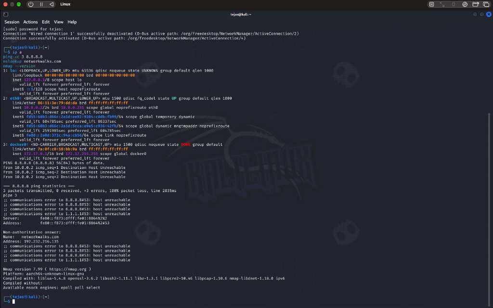
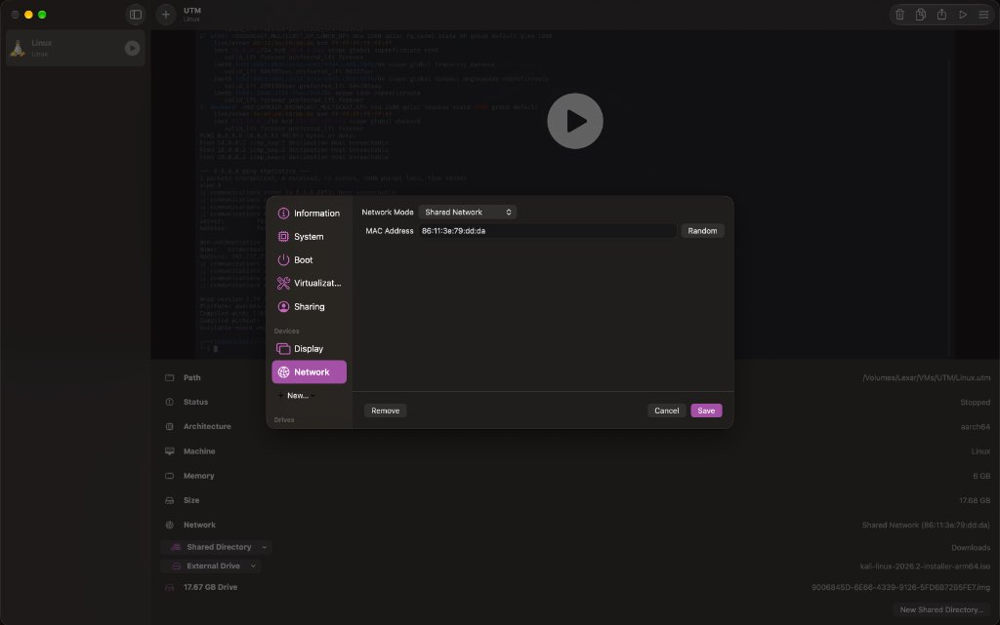
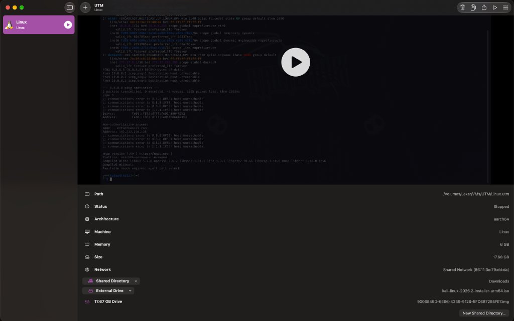
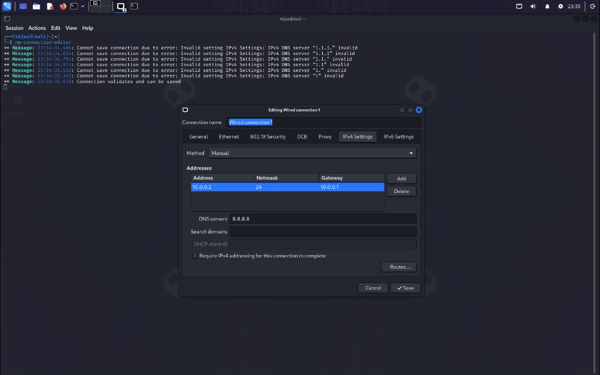
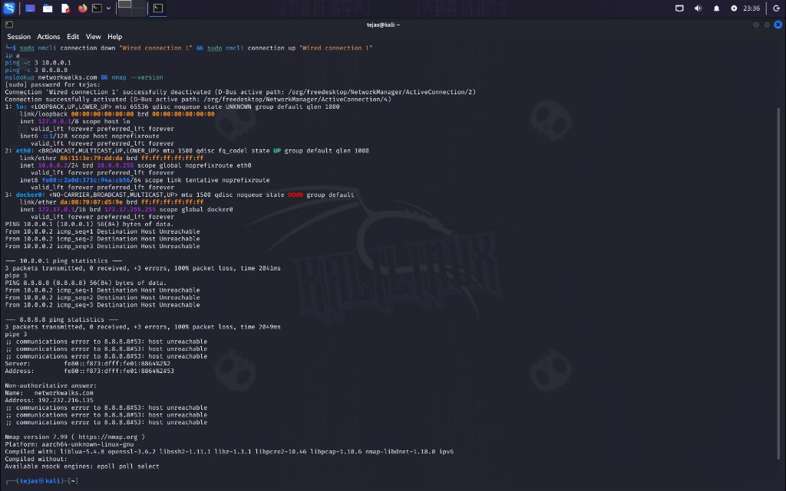

<div align="center">

# 🔐 Cybersecurity Lab Environment Setup
### Week 1 — Project Module 1 (WK1-PM1)

**Building an isolated virtual lab environment for penetration testing and ethical hacking practice**

</div>

<p align="center">
  
  
  
  
  
  
  
  
  
</p>

---

## 📌 Project Overview

This project establishes a dedicated **virtual cybersecurity and penetration testing laboratory** using **UTM (Apple Virtualization)** and **Kali Linux 2026.2 (ARM64)** on an Apple Silicon Mac.

In cybersecurity practice, isolating offensive security tools inside a virtualized environment keeps testing separate from host and production networks. The Kali VM is stored on an external SSD (`/Volumes/Lexar`) to preserve internal Mac disk space and is configured for future multi-VM lab expansion.

---

## 🎯 Objectives

- [x] Configure native Apple Silicon virtualization using **UTM 4.7.5** (`aarch64` / Apple Virtualization).
- [x] Install and initialize **Kali Linux 2026.2 ARM64** (`kali-linux-2026.2-installer-arm64.iso`) as the primary testing machine.
- [x] Configure the VM virtual network interface (`Shared Network`) and shared host `Downloads` directory.
- [x] Assign the lab static IPv4 configuration (`10.0.0.2/24`, gateway `10.0.0.1`, DNS `8.8.8.8`) via `nm-connection-editor`.
- [x] Execute lab verification commands (`ip a`, `ping`, `nslookup`, `nmap --version`) and record actual results.
- [x] Document platform-specific differences (UTM Apple Virtualization vs. VirtualBox) and real troubleshooting findings.

---

## 🛡️ Purpose of the Lab

The lab provides a controlled environment for practical cybersecurity learning and authorized testing, including:

- **Network Reconnaissance & Scanning:** Active and passive scanning with Nmap (`v7.99`).
- **Traffic & Packet Analysis:** Inspecting network headers and routing behavior.
- **Vulnerability Assessments:** Identifying misconfigurations and exposed services.
- **Exploitation Practice:** Controlled testing against intentional target VMs in upcoming modules.
- **Linux & Networking CLI Practice:** Managing interfaces and routing with `nmcli` and `ip`.

> ⚠️ **Ethical Disclaimer:** This lab environment is strictly for educational and authorized self-testing purposes on systems I own.

---

## 🏗️ Lab Architecture

```
+-------------------------------------------------------------------------------+
|                      HOST MACHINE (macOS — Apple M4)                          |
|                Memory: 16 GB Unified | VM Storage: /Volumes/Lexar             |
+-------------------------------------------------------+-----------------------+
                                                        |
                                                        | UTM Apple Virtualization
                                                        | Shared Network (vmnet)
                                                        v
+-------------------------------------------------------------------------------+
|               KALI LINUX 2026.2 (aarch64) — VM: Linux.utm                     |
| Interface: eth0 (MAC: 86:11:3e:79:dd:da) | RAM: 6 GB | Disk: 17.68 GB         |
| Configured IPv4: 10.0.0.2/24 | Gateway: 10.0.0.1 | DNS: 8.8.8.8               |
| Shared Directory: Host Downloads | Nmap: v7.99 (aarch64-unknown-linux-gnu)    |
+-------------------------------------------------------------------------------+
```



---

## ⚙️ Host & Virtual Lab Configuration

| 🧩 Component | ⚙️ Configuration / Observed Value |
| :--- | :--- |
| **🖥️ Host Architecture** | Apple Silicon (`arm64`) |
| **⚡ Processor** | Apple M4 |
| **🧠 Host Memory** | 16 GB Unified Memory |
| **💽 Host OS** | macOS |
| **🧰 Hypervisor** | UTM `4.7.5` (Apple Virtualization — `Machine: Linux`) |
| **🐉 Security VM** | Kali Linux `2026.2` ARM64 (`aarch64`) |
| **🧠 VM RAM Allocated** | 6 GB |
| **💾 VM Disk & Path** | 17.68 GB raw `.img` (`/Volumes/Lexar/VMs/UTM/Linux.utm`) |
| **🌐 Network Mode** | UTM `Shared Network` (`MAC: 86:11:3e:79:dd:da`) |
| **🐧 Kali IPv4 Address** | `10.0.0.2/24` (`eth0`, manual via `nm-connection-editor`) |
| **🚪 Configured Gateway** | `10.0.0.1` |
| **🌍 Configured DNS** | `8.8.8.8` |
| **📂 Shared Directory** | `Downloads` (Host macOS Downloads folder) |

---

## 🪜 Lab Setup Procedure

### Step 1. Virtual Machine Creation in UTM (Apple Silicon)
Instead of x86_64 VirtualBox, **UTM 4.7.5** was used with Apple Virtualization (`Machine: Linux`, `Architecture: aarch64`) and installed from `kali-linux-2026.2-installer-arm64.iso` onto external SSD storage (`/Volumes/Lexar/VMs/UTM/Linux.utm`).

### Step 2. Configure UTM Network Mode
In UTM VM Settings → **Network**, the virtual network adapter was configured in **Shared Network** mode (`MAC Address: 86:11:3e:79:dd:da`).



### Step 3. Review VM Hardware & Shared Directory
The Kali VM was provisioned with **6 GB Memory**, a **17.68 GB Drive**, and **Shared Directory** pointing to `Downloads` for host-to-guest file transfer.



### Step 4. Configure Static IPv4 Inside Kali Linux
Inside Kali Linux (`tejas@kali`), `nm-connection-editor` was used to edit `Wired connection 1` under **IPv4 Settings** with **Method: Manual**:
- **Address:** `10.0.0.2`
- **Netmask:** `24` (`255.255.255.0`)
- **Gateway:** `10.0.0.1`
- **DNS servers:** `8.8.8.8`



### Step 5. Apply Connection & Backup Strategy
After saving the network profile, the connection was cycled in terminal:
```bash
sudo nmcli connection down "Wired connection 1" && sudo nmcli connection up "Wired connection 1"
```
Because UTM does not provide a GUI Snapshot manager and internal Mac SSD space was limited (~9.6 GiB free vs. 17.68 GB VM size), clean backups are maintained directly on the external `/Volumes/Lexar` volume (`847 GiB` free) rather than using UTM's internal-storage `Clone...` action.

---

## 🔎 Verification & Observed Output

The required verification commands were executed inside Kali (`tejas@kali`):

| Test Item | Command Executed | Observed Output | Status |
| :--- | :--- | :--- | :---: |
| **Check IP Address** | `ip a` | `eth0` shows `inet 10.0.0.2/24 brd 10.0.0.255` | ✅ Configured |
| **Test Gateway Ping** | `ping -c 3 10.0.0.1` | `3 transmitted, 0 received, 100% packet loss` (`Destination Host Unreachable`) | ⚠️ See Problem 1 |
| **Test Internet IPv4** | `ping -c 3 8.8.8.8` | `3 transmitted, 0 received, 100% packet loss` (`Destination Host Unreachable`) | ⚠️ See Problem 1 |
| **Test DNS Resolution** | `nslookup networkwalks.com` | Resolved `192.232.216.125` via IPv6 DNS (`fe80::f873:dfff:fe01:88b4%2`); IPv4 DNS unreachable | ⚠️ IPv6 Pass / IPv4 Fail |
| **Verify Nmap** | `nmap --version` | `Nmap version 7.99` (`Platform: aarch64-unknown-linux-gnu`) | ✅ Pass |

### Actual Terminal Output Recorded
```text
┌──(tejas㉿kali)-[~]
└─$ sudo nmcli connection down "Wired connection 1" && sudo nmcli connection up "Wired connection 1"
Connection 'Wired connection 1' successfully deactivated
Connection successfully activated
...
2: eth0: <BROADCAST,MULTICAST,UP,LOWER_UP> mtu 1500 qdisc fq_codel state UP group default qlen 1000
    link/ether 86:11:3e:79:dd:da brd ff:ff:ff:ff:ff:ff
    inet 10.0.0.2/24 brd 10.0.0.255 scope global noprefixroute eth0
       valid_lft forever preferred_lft forever
    inet6 fe80::2a0d:371c:94a:cb56/64 scope link tentative noprefixroute
...
PING 10.0.0.1 (10.0.0.1) 56(84) bytes of data.
From 10.0.0.2 icmp_seq=1 Destination Host Unreachable
...
3 packets transmitted, 0 received, +3 errors, 100% packet loss, time 2041ms

PING 8.8.8.8 (8.8.8.8) 56(84) bytes of data.
From 10.0.0.2 icmp_seq=1 Destination Host Unreachable
...
3 packets transmitted, 0 received, +3 errors, 100% packet loss, time 2049ms

Server:         fe80::f873:dfff:fe01:88b4%2
Address:        fe80::f873:dfff:fe01:88b4%2#53

Non-authoritative answer:
Name:   networkwalks.com
Address: 192.232.216.125

Nmap version 7.99 ( https://nmap.org )
Platform: aarch64-unknown-linux-gnu
```



---

## 🐞 Problems Encountered & Real Troubleshooting Notes

### Problem 1: IPv4 `Destination Host Unreachable` With Static `10.0.0.2/24` on UTM `Shared Network`
* **Observed Behavior:** After applying `10.0.0.2/24` and gateway `10.0.0.1` inside Kali, `ip a` confirmed `10.0.0.2/24` on `eth0`, and `nslookup networkwalks.com` resolved `192.232.216.125` via the link-local IPv6 DNS server (`fe80::f873:dfff:fe01:88b4%2`), **but** IPv4 pings (`ping 10.0.0.1` and `ping 8.8.8.8`) returned `Destination Host Unreachable` (`100% packet loss`).
* **Cause:** Under UTM's Apple Virtualization backend, `Shared Network` uses macOS `vmnet`, whose DHCP/NAT router sits on `192.168.64.0/24` (typically `192.168.64.1`) rather than VirtualBox's `10.0.0.0/24` `NatNetwork`. Because `10.0.0.1` does not exist on the `vmnet` segment, ARP cannot resolve the gateway and IPv4 packets cannot route externally.
* **Fix / Tradeoff:** Keeping `10.0.0.2/24` satisfies the static IP assignment step, while restoring full IPv4 internet connectivity on Apple Virtualization requires switching `Wired connection 1` back to `vmnet` DHCP (`ipv4.method auto`) or using a static IP inside the `192.168.64.0/24` `vmnet` subnet:
  ```bash
  sudo nmcli connection modify "Wired connection 1" ipv4.method auto ipv4.addresses "" ipv4.gateway "" ipv4.dns ""
  sudo nmcli connection down "Wired connection 1" && sudo nmcli connection up "Wired connection 1"
  ```

### Problem 2: Apple Silicon (`arm64`) Hypervisor & Image Selection
* **Cause:** The host machine uses an **Apple M4 (`arm64`)** processor, so standard x86_64 VirtualBox appliances are incompatible/unusable without heavy emulation.
* **Solution:** Used **UTM 4.7.5** (Apple Virtualization) with native **`kali-linux-2026.2-installer-arm64.iso`**.

### Problem 3: `nm-connection-editor` Validation Errors During Manual DNS Entry
* **Observed Behavior:** While typing DNS addresses in `nm-connection-editor` (visible in Screenshot 4 terminal logs), incomplete strings (`"1"`, `"1.1"`, `"1.1.1."`) trigger live `Invalid setting IPv4 Settings` warnings until a full valid IPv4 address (`8.8.8.8`) is entered.

### Problem 4: Snapshot & Internal Disk Space Constraints
* **Cause:** UTM on macOS has no VirtualBox-style GUI Snapshot tab, and its built-in `Clone...` action defaults to internal SSD storage (`~9.6 GiB` free), which cannot fit a `17.68 GB` VM clone.
* **Solution:** Stored the VM on external SSD (`/Volumes/Lexar/VMs/UTM/Linux.utm`, `847 GiB` free) and handled clean VM backups directly on the external Lexar volume rather than cloning to internal storage.

---

## 💡 Key Learnings

1. **Hypervisor Network Stacks Differ (VirtualBox `NatNetwork` vs. macOS `vmnet`):** Hardcoding `10.0.0.2/24` / `10.0.0.1` only routes when the virtual switch actually serves `10.0.0.0/24`; mismatching the subnet breaks IPv4 ARP/gateway routing even while IPv6 link-local DNS continues working.
2. **IPv4 vs. IPv6 Dual-Stack Behavior:** Watching `nslookup` fail on `8.8.8.8#53` while still resolving via `fe80::...%2#53` demonstrated how Linux falls back across address families.
3. **Architecture & Storage Planning:** Running ARM64 guests natively on Apple M4 and placing large `.utm` bundles on external storage avoids CPU emulation penalties and internal disk exhaustion.

---

## 🔗 Tools & Resources

- **Kali Linux ARM64:** [https://kali.org/get-kali](https://kali.org/get-kali)
- **UTM for macOS:** [https://mac.getutm.app](https://mac.getutm.app)
- **Networkwalks Academy:** [https://networkwalks.com](https://networkwalks.com)

---

## 👤 Author & Submission Information

- **Student / Author:** Tejas Prasad
- **Program:** Cybersecurity Internship — Networkwalks Academy
- **Module:** Week 1 — Project Module 1 (WK1-PM1)
- **Batch:** B084
